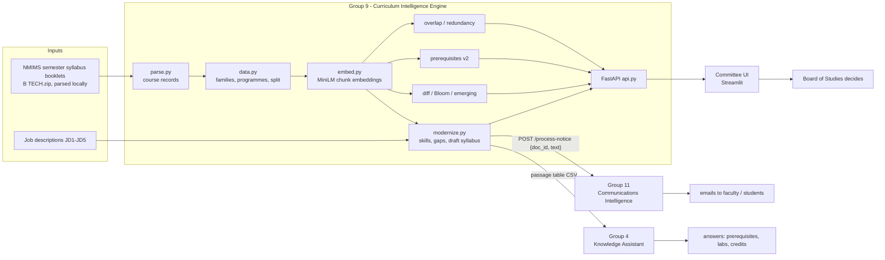

# Architecture

Rendered figure: `results/week7/fig_architecture.png` (generated by `python -m curriculum_engine.run week7`).

The 31 October demo chain follows the instructor's plan: Group 9's draft syllabus goes to Group 11 (communication) and to
Group 4 (student questions). Group 10 (Administrative Copilot) can consume the same draft syllabus JSON for elective advice.
