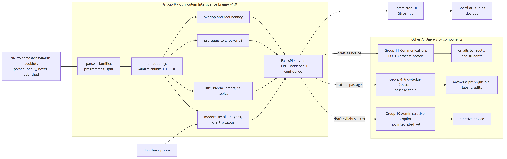

# Architecture



Source: [`docs/architecture.mmd`](architecture.mmd) (Mermaid). Export to PNG (mermaid-cli with the installed Chrome):

```bash
cd tools && npm install && npm run architecture
```

Components, left to right: the NMIMS booklets are parsed locally into course records and course families; MiniLM chunk
embeddings and TF-IDF feed the analysis modules (overlap and redundancy, prerequisite checker v2, curriculum diff, Bloom levels,
emerging topics, curriculum modernisation from job descriptions); the FastAPI service returns JSON with evidence and confidence
to the committee UI, and hands the draft syllabus to Group 11 (notice) and Group 4 (passages).

The 31 October demo chain follows the instructor's plan: Group 9's draft syllabus goes to Group 11 (communication) and to
Group 4 (student questions). Group 10 (Administrative Copilot) can consume the same draft syllabus JSON for elective advice.
